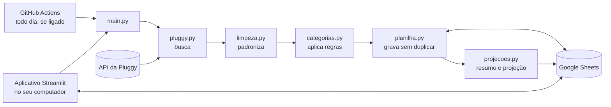

# Bússola

**Saiba no meio do mês se vai sobrar dinheiro no fim dele.**

A Bússola lê as transações da sua conta corrente e do seu cartão pelo Open Finance, organiza tudo por categoria com regras que você define e projeta o resto do mês: quanto você ainda deve gastar, quanto deve fechar a fatura, quais parcelas vão cair e quanto deve sobrar frente à sua meta de economia.

Os dados ficam numa planilha do Google Sheets que é sua, e um aplicativo no seu computador mostra tudo em quatro telas.

## Para quem é

- Para quem quer guardar um valor todo mês e precisa saber, antes do fim do mês, se vai conseguir.
- Para quem tem renda variável, de várias fontes e em datas diferentes, e por isso não consegue usar uma "renda fixa" no planejamento.
- Para quem já tentou controlar gastos copiando extrato para uma planilha e desistiu depois de duas semanas.

## O que ela faz

1. **Busca** as transações pela API da [Pluggy](https://pluggy.ai), uma intermediária autorizada do Open Finance. O acesso é só de leitura.
2. **Padroniza** os dados: gasto sempre negativo, entrada sempre positiva, datas no horário de Brasília. Conta corrente e cartão chegam da API com sinais opostos; aqui isso é resolvido uma vez só.
3. **Categoriza** cada transação com regras que você escreve, como "a descrição contém ENTREGA, então é Alimentação, prioridade Supérfluo". A comparação ignora maiúsculas, acentos e espaços. Sem regra, vale a categoria sugerida pela Pluggy, já em português.
4. **Grava sem duplicar.** Rodar duas vezes não repete nada, e o que você corrige à mão nunca é sobrescrito.
5. **Projeta o mês** com um método simples e explicado na própria planilha.
6. **Mostra tudo num aplicativo** onde você também lança gastos em dinheiro, cria e edita regras e corrige categorias.

## As telas

| tela | para que serve |
|---|---|
| Mês | gasto até hoje e projetado, entradas, sobra frente à meta, gasto por categoria, fatura do cartão e parcelas futuras |
| Semana | gasto por dia, comparação com a semana anterior e com a sua média recente, maiores gastos |
| Lançar | registrar o que não passa pelo banco, como um gasto em dinheiro |
| Regras | criar, editar e apagar regras, ver quantas transações cada uma cobre e corrigir uma transação isolada |

Na barra lateral, um interruptor decide se a busca roda sozinha todo dia ou só quando você aperta "Atualizar agora".

## Como a projeção é calculada

- **Gasto projetado** = gasto até hoje + média diária dos últimos 3 meses × dias que faltam no mês.
- **Renda em dois cenários.** A sobra segura considera só o que já entrou. A sobra provável usa o maior valor entre o que já entrou e a média dos últimos 3 meses. Com renda variável, a diferença entre os dois mostra o tamanho do risco.
- **Fatura do cartão pelo ciclo real**, do último fechamento ao próximo, e não pelo mês do calendário.
- **Movimentos internos não contam.** Pagar a fatura, transferir entre contas suas e investir não são gasto nem renda. Sem isso, cada compra no cartão seria contada duas vezes: na compra e no pagamento da fatura.

O resumo mensal usa fórmulas da própria planilha (`SUMIFS`), para que cada número possa ser conferido.

## Arquitetura



A planilha é o centro. O robô agendado e o aplicativo usam o mesmo código da pasta `bussola/`, então nunca calculam números diferentes.

| aba | quem escreve | conteúdo |
|---|---|---|
| `transacoes` | o robô e o aplicativo, só acrescentando linhas | uma linha por transação |
| `regras`, `contas_fixas`, `metas` | você (as regras também pelo aplicativo) | regras de categoria, contas recorrentes e meta de economia |
| `resumo_mensal`, `projecao` | o código, recalculando | totais por mês e categoria, e a projeção do mês |
| `config` | o aplicativo | se a atualização automática está ligada |

## Segurança

Dados bancários pedem cuidado antes de funcionalidade. As decisões:

- **Só leitura no banco.** Não existe nenhuma chamada que movimente dinheiro.
- **Você decide quando o banco é consultado.** Com o interruptor desligado, a execução agendada termina antes de abrir a conexão; um teste falha se isso mudar.
- **Nenhuma chave do Google guardada.** No GitHub Actions, o login usa Workload Identity Federation: o Google aceita um token emitido pelo GitHub, restrito a um único repositório. No computador, usa a credencial do `gcloud` com impersonação da conta de serviço.
- **Segredos fora do código**, num `.env` ignorado pelo Git e nos Secrets do GitHub, com `detect-secrets` barrando commits suspeitos.
- **Logs só com contagens.** O log diário mostra "14 transações novas", nunca descrições, valores ou saldos.
- **O aplicativo só atende o próprio computador.** Ele não tem login, então fica preso a `localhost`; um teste confere a configuração.
- **Texto do banco nunca vira fórmula.** Uma descrição começando com `=` é gravada como texto.
- **O código só reescreve o que ele mesmo calcula.** As abas que você edita nunca são reescritas inteiras.
- **Workflow com permissões mínimas** e ações de terceiros presas a um commit exato.

## Experimente sem nenhuma conta

O modo demo usa transações fictícias e uma planilha em memória. Não acessa a Pluggy nem o Google.

Precisa de Python 3.13.

```bash
git clone <endereço deste repositório>
cd <pasta do repositório>
python -m venv .venv

# Windows (PowerShell)
.venv\Scripts\Activate.ps1
# Linux ou macOS
source .venv/bin/activate

pip install -e ".[dev,app]"
```

Abra o aplicativo com os dados fictícios:

```bash
# Windows (PowerShell)
$env:DATA_MODE = "demo"; streamlit run app/Bussola.py
# Linux ou macOS
DATA_MODE=demo streamlit run app/Bussola.py
```

Tudo o que você lançar ou mudar no modo demo fica só na memória e some ao fechar.

No Windows, se o `pip` falhar com um aviso sobre "Long Path", clone numa pasta com caminho mais curto.

## Testes

```bash
pytest
mypy
```

Os testes rodam só com dados fictícios e respostas falsas da API. Cobrem a padronização, as regras (acentos, maiúsculas, espaços, empate entre regras, linhas corrigidas à mão), a deduplicação, a projeção do mês, o resumo da semana, os lançamentos manuais, o interruptor e as quatro telas do aplicativo. O GitHub Actions roda tudo a cada envio de código.

## Usar com os seus dados

Você vai precisar de:

1. Uma conta na Pluggy com o conector Meu Pluggy e o seu banco conectado, e uma aplicação no painel da Pluggy para obter `PLUGGY_CLIENT_ID`, `PLUGGY_CLIENT_SECRET` e `PLUGGY_ITEM_ID`.
2. Uma planilha do Google Sheets com estas abas e cabeçalhos:

   | aba | cabeçalho (nesta ordem) |
   |---|---|
   | `transacoes` | `id`, `data`, `descricao`, `valor`, `tipo`, `conta`, `categoria`, `prioridade`, `categorizado_por`, `parcela`, `total_parcelas`, `importado_em` |
   | `regras` | `palavra_chave`, `categoria`, `prioridade` |
   | `contas_fixas` | `nome`, `valor_estimado`, `dia_vencimento`, `categoria`, `prioridade`, `parcelas_restantes` e, opcional, `referencia` |
   | `metas` | `meta`, `valor_alvo`, `prazo`, `observacao` |

3. Um projeto no Google Cloud com a Google Sheets API ativa e uma conta de serviço com acesso de Editor à planilha.
4. O arquivo `.env`, a partir do `.env.example`.

No computador, faça login no `gcloud` com impersonação da conta de serviço:

```bash
gcloud auth application-default login --impersonate-service-account=<e-mail da conta de serviço>
```

Depois:

| comando | o que faz |
|---|---|
| `python -m bussola.main` | busca, categoriza, grava e refaz as projeções |
| `python -m bussola.main --dias 180` | o mesmo, trazendo mais histórico |
| `streamlit run app/Bussola.py` | abre o aplicativo (no Windows, `abrir_bussola.bat`) |
| `python -m bussola.sugestoes` | lista as descrições mais frequentes ainda sem regra |

### Execução diária no GitHub Actions (opcional)

1. No Google Cloud, crie um pool de Workload Identity Federation com um provedor OIDC do GitHub, aceitando só o seu repositório, e dê ao repositório o papel `roles/iam.workloadIdentityUser` na conta de serviço.
2. No repositório, cadastre os **Secrets** `PLUGGY_CLIENT_ID`, `PLUGGY_CLIENT_SECRET`, `PLUGGY_ITEM_ID` e `SHEET_ID`.
3. Cadastre as **Variables** `GCP_PROJECT_ID`, `GCP_WORKLOAD_IDENTITY_PROVIDER` (o nome completo do provedor) e `GCP_SERVICE_ACCOUNT`.

Sem essas Variables, o workflow diário fica parado e não gasta nada.

## Estrutura

```
bussola/
  config.py       variáveis de ambiente
  pluggy.py       cliente somente leitura da API da Pluggy
  limpeza.py      sinais, datas e nomes padronizados
  categorias.py   regras de categoria
  planilha.py     leitura e escrita no Google Sheets
  projecoes.py    resumo mensal e projeção do mês
  semana.py       resumo de uma semana
  lancamentos.py  lançamentos manuais e correção de categoria
  demo.py         dados fictícios
  sugestoes.py    descrições ainda sem regra
  formatos.py     reais, meses e períodos por extenso
  main.py         orquestra as etapas
app/
  Bussola.py      entrada do aplicativo e barra lateral
  dados.py        leitura e atualização da planilha para as telas
  paginas/        uma tela por arquivo
tests/            testes com pytest
.github/workflows/
  atualizar.yml   execução diária
  testes.yml      testes a cada envio de código
```

## Limites conhecidos

- O aplicativo roda no computador; não há versão para celular.
- Funciona com um banco por vez.
- A data de vencimento da fatura aberta é estimada a partir da fatura anterior.
- A média dos últimos 3 meses engana quando um mês foge muito do padrão.
- Parcelas da mesma compra são reconhecidas pela descrição; duas compras iguais na mesma loja, com o mesmo número de parcelas, seriam tratadas como uma só.
- Lançar à mão algo que também passa pelo banco faz a transação contar duas vezes.

## Tecnologias

Python 3.13, pandas, requests, gspread, google-auth, Streamlit, Altair, pytest, mypy, GitHub Actions, Google Sheets API, API da Pluggy (Open Finance).
